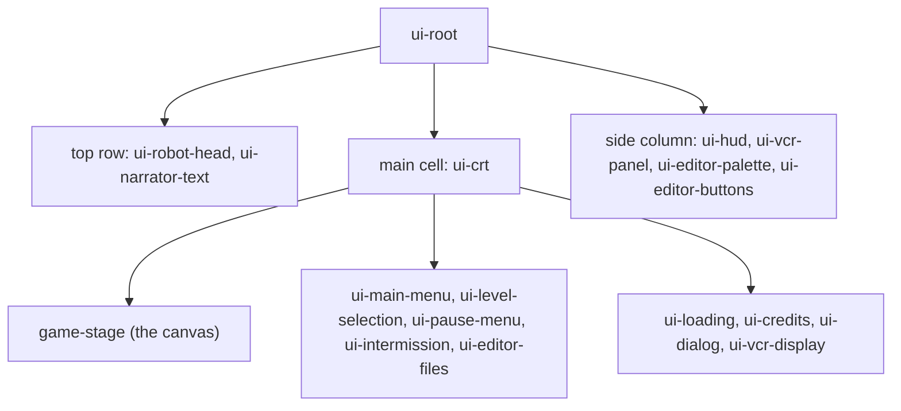
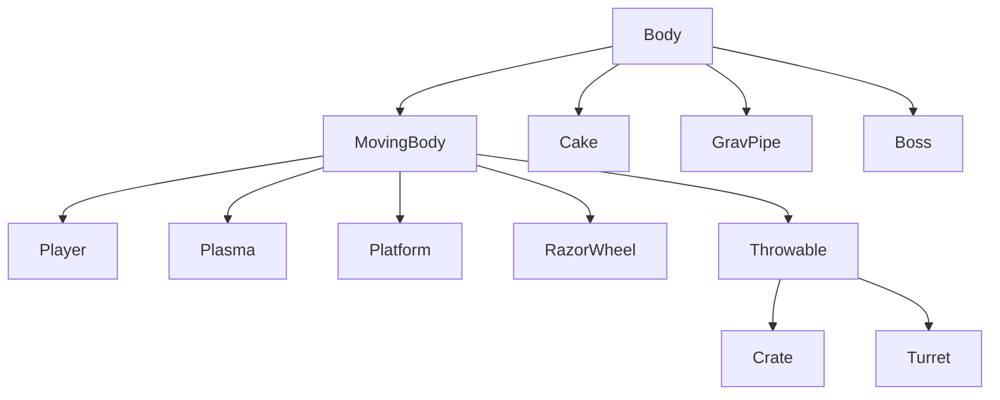
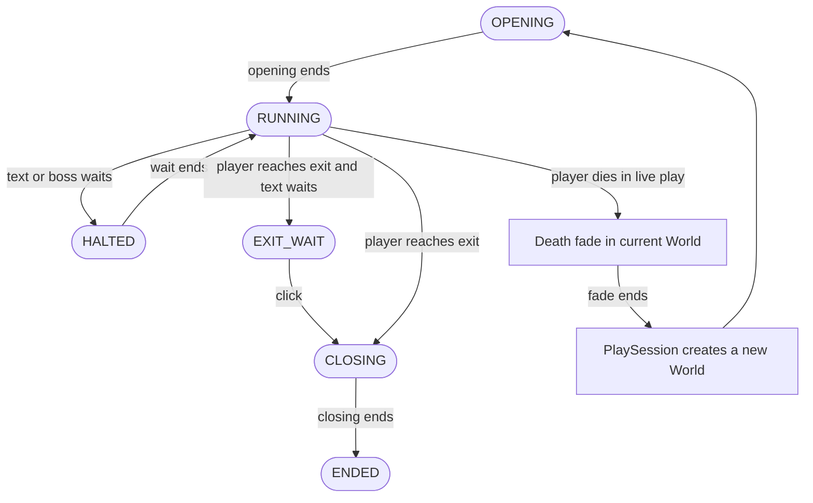
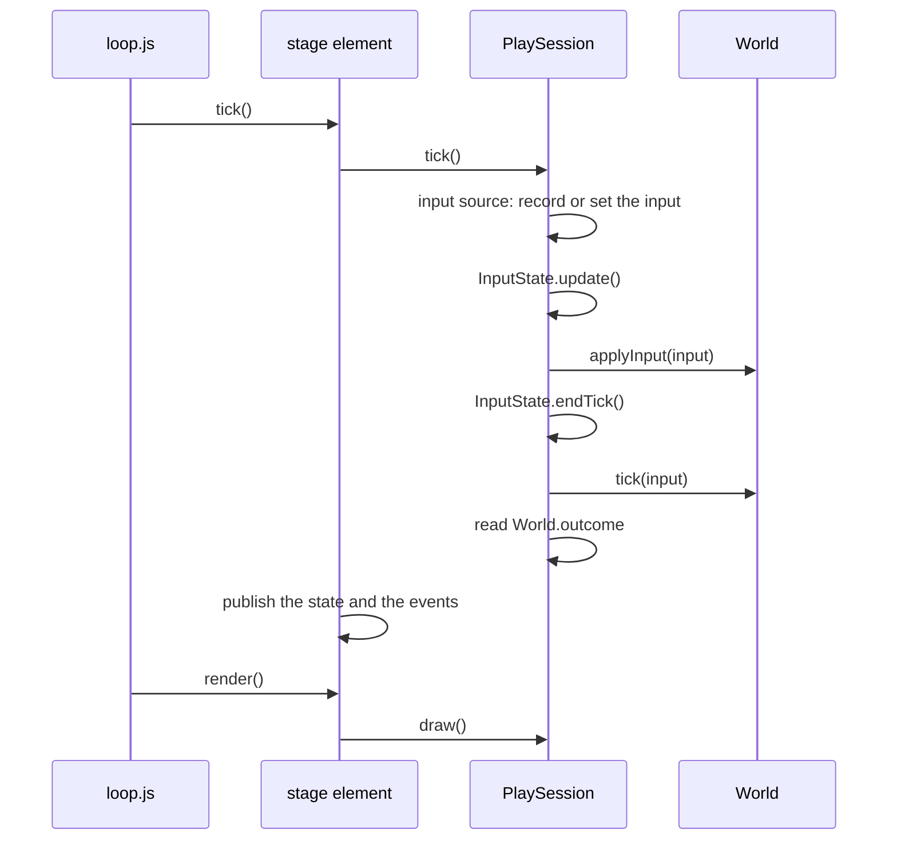
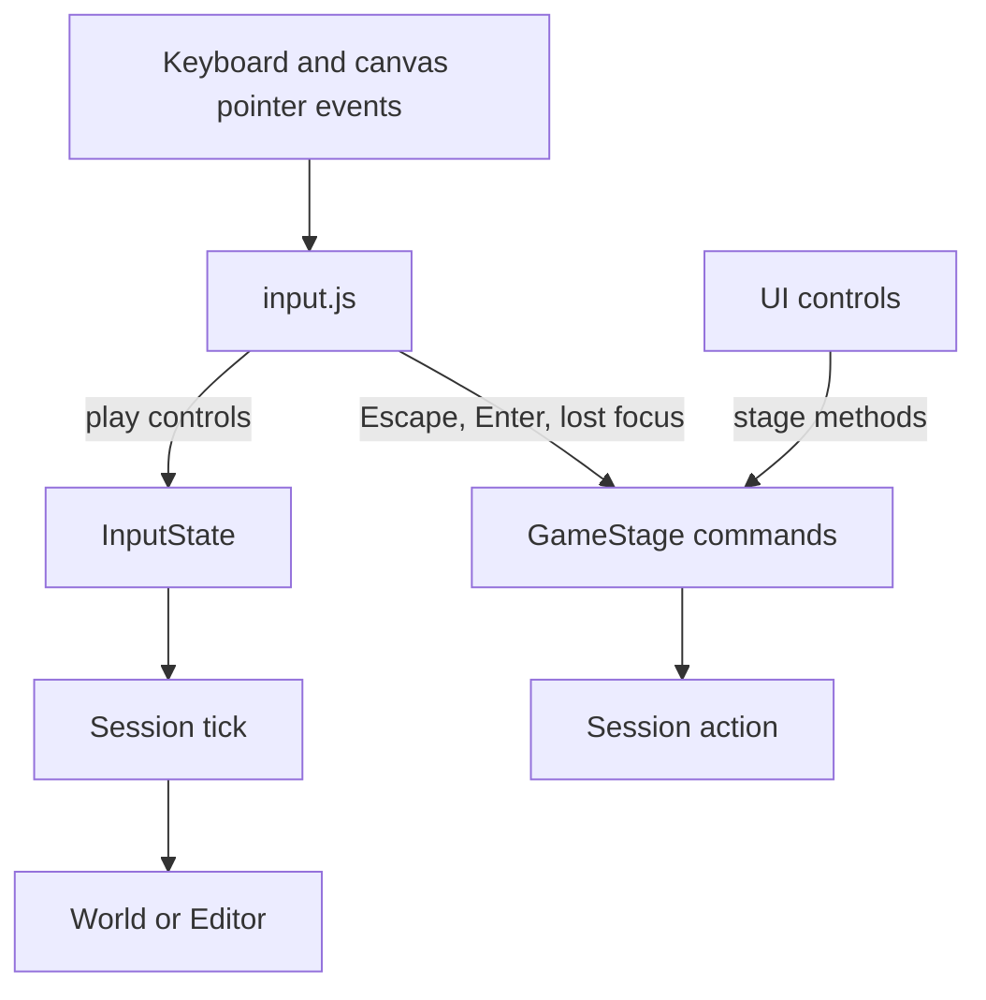
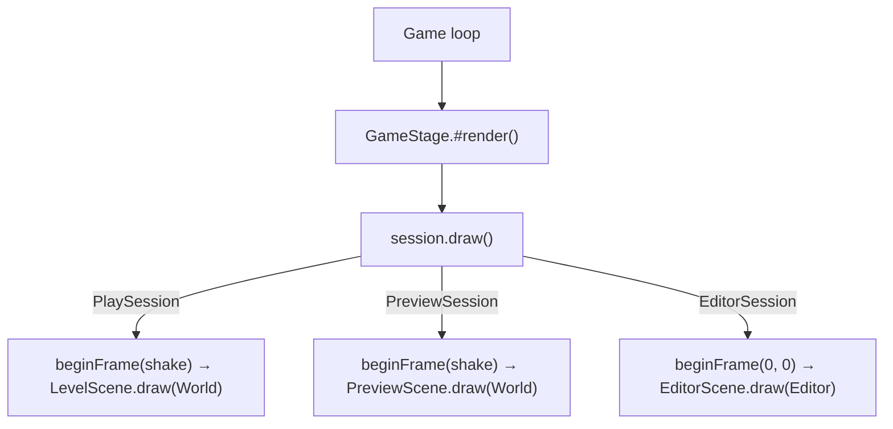
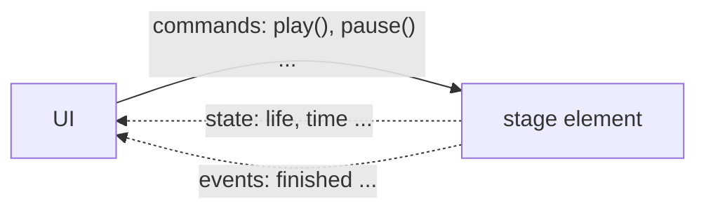
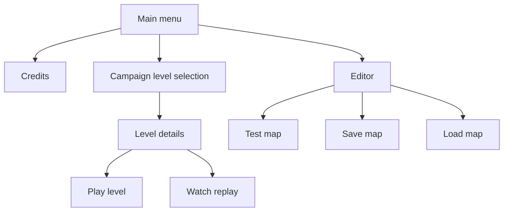
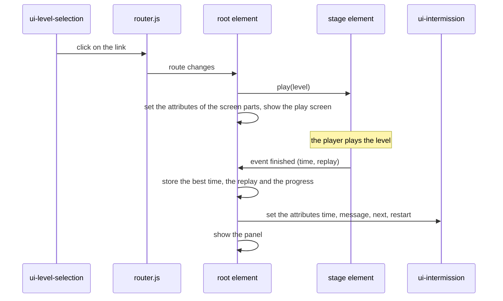
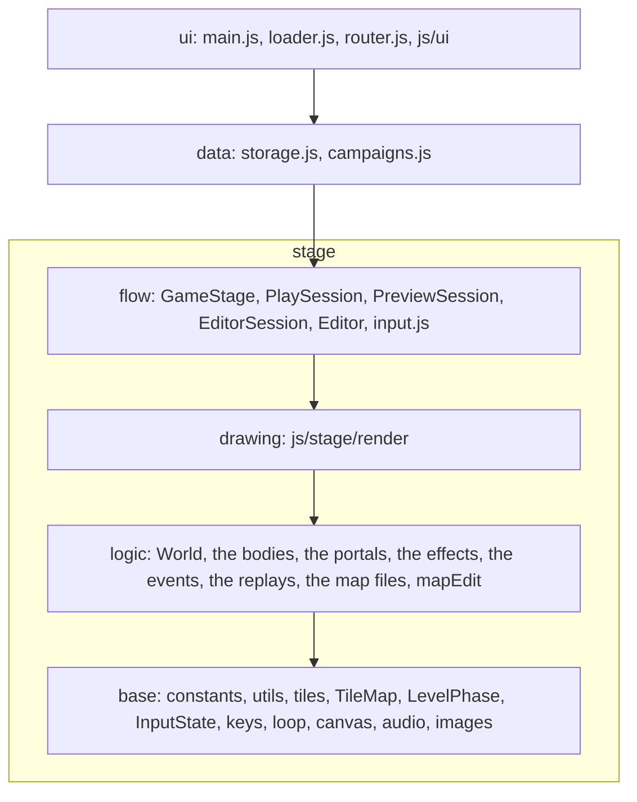

# Architecture

## 1. Overview

### 1.1 Technology

Still Alive Revived is a static website. It uses ES modules, web components, SVG, the canvas element, and the Web Audio
API. It has no build step, framework, or library. The browser loads modules directly from `js/`. For development,
`npm start` serves the project folder on port 8080. The original game had no dependencies, which made its revival
possible after fifteen years. The revived version follows the same rule.

The revived version uses the original game logic, physics engine, and units, so the levels play as they did. The user
interface now uses HTML and CSS instead of canvas drawing. CSS adapts the layout to different screen sizes. The graphics
are SVG files, so they stay sharp at every size.

### 1.2 The parts of the code

The code has three parts: the stage, the UI, and the data.

The **stage** contains the canvas playfield, game logic, keyboard and mouse input, drawing, sound, and music. Its code is
in `js/stage/`. The custom element `<game-stage>` connects the stage to the page. The sections below call it the stage
element. Chapter 2 describes the stage.

The **UI** contains the menus, HUD, narrator text, editor panels, replay controls, and URL handling. Its web components
are in `js/ui/`.

The **data layer** in `js/data/` loads campaigns and their levels. It also manages player progress, best times,
replays, and editor maps in browser storage. Its modules do not display data. Chapter 3 describes the UI and data
layer.

The stage imports no UI or data modules and accesses no page elements. The UI calls methods on the stage element, reads
its state, and listens to its events (see 2.15). This one way dependency keeps the game logic independent of the UI.
The tests use the stage without menus, and the unit tests run the game logic in Node (see chapter 5).

### 1.3 The page

`index.html` contains all game elements. Elements that are not always visible have the `hidden` attribute. CSS defines
the layout. The root element shows or hides elements when the screen changes.

`<ui-root>` encloses the game. The sections below call it the root element. `style.css` arranges it in a grid with a narrow
top row, a narrow side column, and a large main cell. The top row contains the robot head and narrator text. The side
column contains the HUD, replay controls, and editor palette. The main cell contains `<ui-crt>`, a monitor frame with
the stage and menus on its screen. In a window that is taller than it is wide, the side column moves below the main
cell.

### 1.4 Folders

| Folder                                | Content                                                                                                 |
| ------------------------------------- | ------------------------------------------------------------------------------------------------------- |
| `js/`                                 | The start code `main.js`, the loader, the router and the class `Value`.                                 |
| `js/ui/`                              | The UI: the base class of the elements and helpers.                                                     |
| `js/ui/elements/`                     | The web components of the UI, one module and one HTML file per element.                                 |
| `js/data/`                            | The data: the campaigns and the storage.                                                                |
| `js/stage/`                           | The stage: the stage element, the constants and the helpers. The subfolders hold the rest of the stage. |
| `js/stage/sessions/`                  | The sessions that play or show a level, and the replays.                                                |
| `js/stage/editor/`                    | The level editor, the rules of a valid map and the undo list.                                           |
| `js/stage/world/`                     | The World and its parts, e.g. the tile map, the level phase and the events.                             |
| `js/stage/bodies/`                    | The bodies of a level, e.g. the player, the crates and the boss.                                        |
| `js/stage/portals/`                   | The portals.                                                                                            |
| `js/stage/effects/`                   | The visual effects: the sparkles and the security camera.                                               |
| `js/stage/map/`                       | The tile ids and the map file format.                                                                   |
| `js/stage/render/`                    | The scenes, painters and cached layers that draw the stage.                                             |
| `js/stage/browser/`                   | The connection to the browser: the input, the game loop, the canvas, the images and the sound.          |
| `maps/`                               | The campaigns and their map files.                                                                      |
| `gfx/`, `sounds/`, `music/`, `fonts/` | The images, the sounds, the music and the fonts.                                                        |
| `tests/`                              | The Playwright tests and, in `tests/unit/`, the unit tests of the game logic.                           |

## 2. The stage

### 2.1 Maps, tiles and bodies

A **map** contains the data for a playfield. Its JSON object contains 768 tile IDs for a 32 x 24 grid, a background
image number, and optional properties. Campaign maps, editor save slots, and exported maps use this format.
`maps/README.md` describes the properties. `parseMap()` in `mapFile.js` checks a map and supplies default values.

A **tile** is one cell of the 32 x 24 grid. Tile IDs below 100 identify tiles in the tile set. Each ID has an SVG
image in `gfx/tiles/`. The `Tile` object in `tiles.js` names the IDs. `TileKind` groups related tiles, such as doors.
Animated tiles have one ID per frame. Game logic uses `isTileKind()` to test a kind instead of comparing frame IDs.

`TileMap` stores tile IDs in two arrays. Game logic reads the **logic layer**, `tiles`, and drawing reads the **display
layer**, `display`. At a level start, an animated tile keeps its ID in the logic layer, while its painter draws it over
an empty cell in the display layer.

A **body** has a position and size outside the tile grid and takes part in level physics. The player and crates are
examples. A body can stay in place, as a gravitational pipe does. All body classes in `js/stage/bodies/` extend `Body`
(see 2.3). Portals and visual effects are separate from bodies (see 2.4 and 2.7).

Some map tile IDs mark where bodies or the player start. At level start, the game uses these markers to create bodies
and then removes the markers from the map (see 2.2). `maps/README.md` lists the marker IDs.

A **level** is a parsed map with its campaign ID and level number. `levelFromMap()` in `level.js` creates this
in-memory `Level` object from a map file. Campaign loading, editor tests, and previews of editor maps use this
function. The ID and number identify the level in replay files. The stage receives the `Level` object and does not
read the map file.

### 2.2 The World

A `World` (`World.js`) contains the state of one playfield. It combines the `TileMap` and bodies with portals, effects,
level phases, events, and counters for the HUD. Methods on `World` and its bodies implement the game rules. Each level
start and each restart after a death creates a new `World`. State from one attempt cannot affect the next.

`new World(level)` starts a level. Its constructor calls `createBodies()` in `mapBodies.js` to create bodies from the
body tile IDs and remove those IDs from the map. It also starts the plasma balls, sets the player's launch speed, and
closes the exit while cakes remain. A preview uses the same level start state and leaves it unchanged (see 2.9).

`World.tick(input)` advances a level in a fixed order. It updates the player and switches before the other bodies and
effects. It then updates the boss and level events. The order is part of the game rules. Section 2.8 shows where this
step occurs in a session tick. `World` calls `move()` on a body while level time runs and `idle()` while it stands still
(see 2.6). It removes a body from its list when the body's `gone` property becomes true.

Bodies use `World` queries to check nearby tiles, bodies, and gravitational pipe fields. The queries also define what
counts as solid during collision checks.

### 2.3 Bodies and their movement

The body classes are in `js/stage/bodies/`. Each body has a reference to its `World`. `Body` defines `readInput()`,
`move()`, `idle()` and `gone`, so `World` can update all body types through the same methods. The player uses
`readInput()` to set its controls. A moving body uses `move()` to change position and resolve collisions. Some bodies
also use `idle()` to update while level time stands still.

All bodies extend `Body` (`Body.js`). A `Body` has position fields `x` and `y`, size fields `width` and `height`, and
methods to check nearby tiles and bodies. Bodies with speed extend `MovingBody` (`MovingBody.js`). It adds `vx`, `vy`,
and methods for ground checks, collisions, and portal travel. Cakes, gravitational pipes, and bosses have no speed, so
they extend `Body` directly.

Position and speed are integers in units of 1/256 pixel. Size is in pixels. The game logic uses only integer
arithmetic, so it gives the same result on every machine. Replays and regression tests depend on this. The helpers
`toPixels()` and `toSubpixels()` in `utils.js` convert between the units. The `Body` getters `pixelX` and `pixelY`
return position in whole pixels.

`Throwable` covers crates and turrets, which the player can pick up and throw. Each `GravPipe` creates a
`GravPipeField` from the pipe to the first wall in every tick. Players, crates, and turrets in the field float along
it. `GravPipeField` is not a body; its class is in `GravPipe.js`.

#### Collision detection

`MovingBody` handles collisions for every moving body. It divides each move into eight steps of one eighth of the
speed, so a fast body cannot pass through a thin wall. After the move, `checkCollisions()` samples points along all
four sides and counts the solid tiles on each side. The side with the most solid tiles is the collision side. The method
sets speed in that direction to zero. It moves the body out of the tile one pixel at a time until the side is free, then
repeats until no side touches a solid tile. `World` queries define solid objects, including crates and platforms.

### 2.4 Portals

`PortalPair` (`PortalPair.js`) implements the game's portals. It holds two `Portal` objects: the blue portal with index
0 and the red portal with index 1. Each portal has a position, a wall tile, and a direction that specifies the side of
the wall to which it opens.

`Player.move()` calls `PortalPair.launchPortal()` when the player clicks. That call traces the full shot in one tick,
one pixel at a time. The shot follows a line towards the mouse position, passes through empty tiles and most bodies,
and bounces off icy walls. It places a portal on the first suitable wall or platform. A wall that cannot hold a portal,
such as warning stripes, ends the shot. Sparkles then show the shot's path over later ticks.

Each `MovingBody` checks for a portal once per tick in `move()`. It checks whether it can pass through a portal in
front of it. After the body enters far enough, `PortalPair` calls `MovingBody.teleport()`. The body moves to the exit
portal and turns its speed according to the difference between the portal directions. For example, a body that falls
into a floor portal flies sideways from a wall portal. `TELEPORT_TURNS` in `MovingBody.js` gives the speed turn for
each pair of directions. A portal placed on a moving platform moves with that platform.

### 2.5 Bosses

A boss level has a `boss` property from 1 to 4. The `Boss` class (`Boss.js`) extends `Body` and controls the fight.
Its body position and size define the hit box for crates. The image position differs from the hit box, so drawing uses
`imageX`. The boss is outside the `World` body lists because other bodies do not collide with it. A separate check
handles contact with the player.

The level stops while the boss enters. `Boss` sets screen shake in `World.effects`, which shifts the drawing. After
the entrance, `attack()` runs once per tick while level time runs. Three crate hits kill the boss. Between hits, boss
blocks return and protect it. The death triggers `bossDied`, a level event that the map uses for narrator text.

Each boss is a subclass of `Boss` in `bosses.js`, and a subclass defines only its attacks. The `CrateBoss` throws
crates, the `RazorWheelBoss` throws razor wheels, the `PlasmaBoss` shoots plasma balls that follow the player, and the
`FinalBoss` uses all three attacks, one more after each hit. `createBoss()` creates the boss of a level from its number.

### 2.6 Level phases and events

#### Level phases

The `LevelPhase` object of the `World` holds the phase of the level. The bodies move and the input is recorded only in
the phase `RUNNING`.

- `OPENING` is the transition at the start, during which the picture appears. The level time does not count yet.
- `RUNNING` is the normal play.
- `HALTED` stops the level time while a narrator text waits for a click or while the boss comes in.
- `EXIT_WAIT` starts after the player reaches the exit, while an exit text waits for a click.
- `CLOSING` is the transition at the end, during which the picture disappears.
- `ENDED` is the frozen picture after the closing transition, until the UI shows the next screen.

The diagram shows the level phases and the restart after player death. Rounded boxes show phases. Rectangular boxes
show the steps of a restart.

In live play, the death fade uses the current `World` and its current `LevelPhase`. When the fade ends, the `World` sets
its outcome to `died`. `PlaySession` then creates a new `World` at `OPENING` (see 2.9). `ENDED` follows the exit closing
transition.

#### Level events

The **events** of a level are the scripted moments of a map: a narrator text at the start, at a given time or when the
player passes a column, a wait for a click, the unlock of an ability like jumping or the portal gun, or portals that the
level places for the player. The tutorial uses them to teach the controls. The `LevelEvents` object of the `World` fires
each event once when its trigger happens, and it holds the current message of the narrator. The stage element publishes
the message to the UI, and `<ui-narrator-text>` types it. `maps/README.md` lists the triggers and the actions.

### 2.7 Effects

**Effects** change the picture without changing the game rules. They include sparkles, the security camera, and screen
shake. Each `World` stores them in an `Effects` object (`effects/Effects.js`). Drawing reads them from that object.

The `Sparkle` classes in `sparkles.js` are the particles of the visual effects: the stars along a portal shot and around
a teleport, the crumbs of an eaten cake, the smoke of a destroyed turret and of the dead boss, the blood of a hit, and
the glow along a portal. A sparkle has a position and a speed, moves in each tick and fades. The bodies add sparkles
through `effects.addSparkle()` and the other helpers of `Effects`. A sparkle stops at the tiles, the crates and the
platforms, and the glow follows the portals, so a sparkle keeps a reference to the `World`.

The security camera (`Camera.js`) floats behind the player and swings. The shake is the shift of the whole picture in a
boss level, which `Boss` sets with `effects.shake()` during the entrance and the leave of the boss.

The `World` updates effects once per tick, and drawing only reads them. At quadruple replay speed, effects also move
four times as fast. Sparkles move in the tick order, using the current positions of tiles, crates, and platforms. The
camera moves after the platforms because it follows the player. Within game logic, random numbers appear only in effects
and transitions. A replay can therefore show different sparkles while the level runs the same way.

### 2.8 Ticks and frames

Game logic advances in **ticks** of exactly 1/60 second. One tick calls `World.tick()` once and moves each body one
step. A **frame** is one canvas drawing, scheduled by the browser. The separate schedules make level behavior the same
on every machine. Replays can run on another machine, and tests can compare runs tick by tick. Running game logic once
per frame would make its speed depend on the display.

`loop.js` contains the game loop. `startLoop(tick, render)` registers a frame callback with
`requestAnimationFrame()`. For each frame, the callback measures the time since the previous frame. It calls `tick()`
once per 1/60 second of elapsed time, then calls `render()` once if at least one tick ran. On a 60 Hz display, each
frame has one tick and one drawing. On a 120 Hz display, every second frame has no tick or drawing because nothing
changed. On a 30 Hz display, each frame has two ticks and one drawing. After a long frame, the callback runs at most
five ticks and discards the remaining time so the page does not freeze while catching up. The browser stops frames when
the tab is hidden. The stage element pauses the level when focus is lost (see 2.10), and the loop discards the elapsed
time when the tab becomes visible again.

The `tick` callback is a method of the stage element, and this is what happens in one tick of a level:

1. The stage element calls `tick()` of the current session (see 2.9), a `PlaySession` during a level.
2. The session calls `run()` of its input source (see 2.10): the `Recorder` copies the current keys and the mouse
   position into the replay, or the `ReplayPlayer` overwrites them with the recorded values of this tick.
3. The session calls `InputState.update()`, which compares the keys with the previous tick and sets the flags for a new
   press and a release of a mouse button.
4. The session calls `World.applyInput(input)`, which passes the input to each body's `readInput()` method. The player
   sets its control flags from the keys.
5. The session calls `InputState.endTick()` to save the keys for comparison in the next tick.
6. The session calls `World.tick(input)`, which runs one step of the level as described in 2.2.
7. The session reads `World.outcome` and reacts when the level is done, see 2.9.
8. After the last tick of the frame, the stage element copies the state of the `World` into its published state and
   dispatches the events that the session reported (see 2.15), and the loop calls `render`, which draws the session (see
   2.13).

### 2.9 Sessions

A **session** specifies what the stage shows. A `PlaySession` plays a level, a `PreviewSession` shows a still picture of
a level, and an `EditorSession` runs the editor. The stage element holds one session at a time, or none. Each
session provides a `mode`, a `tick()` method and a `draw()` method. Play and preview sessions also contain a `World`.
The editor session draws the editor state. The stage publishes the mode to the UI (see 2.15). The `Session` typedef in
`GameStage.js` describes this structure.

`PreviewSession` creates a `World` from a level, but its `tick()` only updates the input state. The scene therefore
shows the level at its start. The UI makes a level from an editor map before it starts a preview of that map.

`PlaySession` creates its `World` with `new World(level)` and runs the level as described in 2.8. It owns the level's
input source (see 2.10) and restarts the level after a death.

`World.outcome` tells `PlaySession` how to handle the end of an attempt. It stays `null` while the level runs. When
the attempt ends, `World` sets it to one of three values. The session reads it after the tick:

| Outcome        | The World is done because                                                                   | The PlaySession                                                             |
| -------------- | ------------------------------------------------------------------------------------------- | --------------------------------------------------------------------------- |
| `died`         | the death fade is complete.                                                                 | Starts the level again in a new `World`, as a restart.                      |
| `finished`     | the player reached the exit and the closing transition is complete.                         | Reports `finished` with the level time and the replay to the stage element. |
| `brokenReplay` | a replay does not fit the level: the player died, or the replay has no input for this tick. | Ends the playback and reports `brokenreplay`.                               |

A restart skips the narrator waits and the entrance of the boss. A test run of the editor map is a `PlaySession` without
an input source because it does not record a replay or play one back. The player still controls it through `InputState`.
At its end, the session reports `testend` instead of `finished`, and the stage element creates an `EditorSession` for
the same map. The test run ends at the exit, with Enter, or with Escape. A death restarts it.

### 2.10 Input

The stage receives input through browser handlers and through UI controls. The keyboard and canvas pointer handlers in
`input.js` write play controls to `InputState`. The stage reads that state once per tick. UI controls call stage methods
for actions such as resume and editor test. Escape, Enter, and lost focus also call stage commands directly.

The `keys` field of `InputState` is one number with a bit for each held control. For example, the left key and the
left mouse button have separate bits. The pointer handlers also convert the canvas position to playfield pixels. At
the start of a tick, `InputState.update()` compares `keys` with the previous tick to find mouse button changes and a
press of the portal clear key. `World.applyInput()` then passes the input to the bodies. `Player.readInput()` sets the
player controls. A key press affects a tick if the key is still down when the tick reads it. A press and release between
ticks leaves no held key for the next tick.

The handlers use physical key positions. For example, `KeyW` means the key in the W position on a US keyboard. On a
French AZERTY keyboard, that position has the Z label. `keys.js` uses the Keyboard Map API to show the local label in
narrator text such as `{KeyW}`.

Escape pauses or resumes play, stops a replay, or ends an editor test. Enter also ends an editor test. On lost focus or
a hidden tab, the stage releases the live keys and pauses play. A replay keeps its recorded input during lost focus.
The UI reads `paused` to show the pause menu.

A `PlaySession` can use a `Recorder` or a `ReplayPlayer` as its input source. The source runs before
`InputState.update()` in each tick (see 2.8). The `Recorder` stores the key bits and mouse position of each running
tick. The `ReplayPlayer` sets them from the recording. An editor test reads live input without a source.

### 2.11 Replays

A replay plays a level from recorded input. `Recorder` stores the key bitmask and mouse position for every running tick.
`ReplayPlayer` restores those values tick by tick in a new `World` for the same level. Because game logic is
deterministic (see 2.3 and 2.7), playback follows the recorded run and has the same level time. The UI stores the
replay for each level's best time (see 3.6). The replay route plays it at normal, double, or quadruple speed (see 3.3).

A death restarts the level with a new `Recorder`, so a replay contains only the successful attempt. `Recorder` also
stores a snapshot whenever level time resumes after a pause. The snapshot contains the input state and the player's
jump and clear flags, which depend on earlier ticks. The player can change keys during a pause. Playback restores the
snapshot at the same tick to reproduce the recorded flags.

A replay is broken when it does not fit the level anymore: the player dies, or the level still runs when the replay has
no more input. Both mean that the level runs differently from the recording, e.g. after a change of the map or of the
game logic. The `World` then sets the outcome `brokenReplay`.

`replay.js` converts a `Replay` to and from the replay file format: a JSON object with the campaign id, the level number
and the inputs, where a run of ticks with the same input is one entry. The file also stores the total tick count and
the saved states from pauses.

### 2.12 The editor

`Editor` (`Editor.js`) holds the editor map, its background, the brush, and the undo list. `EditorSession` runs its ticks
and draws the `EditorScene`. The stage element retains the `Editor` for the lifetime of the page, so the map remains
available after test runs, previews, and visits to the save or load screen.

The editor's **brush** is the tile or body ID selected in the UI palette. Each tick, `EditorSession` updates
`InputState` and passes it to `Editor.tick()`. The left button paints the tile under the mouse while held. The right
button removes the tile or body there, and the middle button fills the connected area with the brush. Functions in
`mapEdit.js` enforce valid map rules. `build()` selects each wall image from its neighbors so each open side has an edge.
`eraseBodyAbove()` and `eraseBodies()` remove bodies that a new tile or body would overlap. `allowTile()` limits the
number of each body type to at most 30 cakes or 15 crates. The editor updates the map's tiles as the player edits. It
keeps the body tile IDs in the map for drawing (see 2.13).

Every change adds the map to the `UndoList`, which keeps the last eleven maps. Undo and redo put a map of this list back
into the editor.

The UI operates the editor through the stage element: `setBrush()` from the palette, `undo()`, `redo()` and `clearMap()`
from the buttons, `getMap()` to save or export the map, and `edit(map)` to load or import a map. For a test run, the
stage element calls `Editor.testLevel()` to make a level from a copy of the editor map. It then starts a `PlaySession`.

### 2.13 Rendering

The game loop asks the current session to draw after the last tick of a frame (see 2.8 and 2.9). Each session prepares
the canvas and draws its scene. A level or preview scene reads a `World`. The editor scene reads the `Editor` state.
Drawing writes to the canvas without changing either state.

#### The canvas and the units

All drawing uses **playfield pixels**: the playfield is 512 x 384 pixels, 32 x 24 tiles of 16 x 16 pixels. The canvas
element scales with the page, and `canvas.js` keeps the size of the drawing buffer at the size of the element in device
pixels, so the picture is sharp on every display. Each session calls `beginFrame()` to set the scale between playfield
pixels and buffer pixels. Play and preview sessions also pass the screen shake from the `World` as an offset. The editor
passes zero for the offset. The drawing functions never see the scale.

All images are SVG files, which `images.js` loads at the start of the game into module variables, e.g. `tileset[id]` for
the tile images and `crateImage` for the crate. An SVG image has a size in playfield pixels, e.g. 16 x 16 for a tile,
and the browser can draw it at any scale without loss. The drawing of an SVG image is slow, so `drawImage()` in
`canvas.js` draws each image once at the current scale into an offscreen canvas and reuses this copy in every frame. The
function also moves the edges of an image to whole buffer pixels, so two tiles next to each other leave no seam.

#### Scenes and painters

Each session creates a scene for its mode. `PlaySession` creates `LevelScene` for play, test runs and replays.
`PreviewSession` creates `PreviewScene` for a still picture. `EditorSession` creates `EditorScene` for the editor. All
three extend `Scene` (`render/Scene.js`), which calls its painters in their draw order. A painter in `render/painters/`
draws one part of the picture. `Scene.draw(state)` passes the `World` or the `Editor` to each painter. In a level, the
player and crosshair painters read the mouse from `World.input`.

#### Cached layers

The background and tiles change less often than the bodies, so drawing reuses their pixels between frames.
`TileLayerPainter` draws them on the canvas, and `LayerCache` (`render/LayerCache.js`) saves a copy. On later frames, the
cache copies the saved pixels onto the canvas.
It draws the layer again when the map object, `TileMap.version`, background or canvas generation changes. The canvas
generation changes after a resize or when the tab becomes visible. Writes to the display layer increase `version`.
`AnimatedTilePainter` draws animated tiles over the saved layer on each frame.

Each level or preview session has its own tile cache. `EditorLayerPainter` uses a separate cache for the editor map and
its body tile images. It reads the body IDs directly from the editor map. `BrushPainter` draws the brush after the
editor layer, so moving the mouse changes the brush without drawing the map again.

#### The draw order of a level

`LevelScene` (`render/LevelScene.js`) draws a level from back to front:

1. the cached tile layer with the background and the tiles,
2. the animated tiles and the gravitational pipes,
3. the player: the portal gun, the head that turns towards the mouse, and the body,
4. the cakes, the turrets, the plasma balls, the sparkles and the crates,
5. the boss with its razor wheels and its tube,
6. the platforms and the tiles that stand in front of the bodies,
7. the portals, the security camera and the labels,
8. the black overlay of the death fade, the transition at the start or the end, and the crosshair at the mouse.

`TransitionPainter` in `render/painters/transitions.js` reads `LevelPhase` to draw the transition. The transition covers
or reveals the picture with lines or squares. `LevelPhase` stores its progress.

`PreviewScene` draws the cached tile layer, the animated tiles, and the bodies at their start positions.

### 2.14 Sound and music

`audio.js` plays the sounds and the music with the Web Audio API, which can mix many sounds at the same time. Each sound
effect is a `Sound` object in a module constant, e.g. `sfx_jump`. The code that causes a sound plays it: `Player.move()`
calls `playSound(sfx_jump)` when the player jumps, `Cake.eaten()` plays the cake sound, and
`PortalPair.launchPortal()` plays the portal sound. A sound that continues, e.g. the float in a gravitational pipe, is a
loop. The code calls `playLoop()` in every tick while the sound continues, and the loop stops a short time after the
last call.

The music has one track for menus and one for levels. The root element selects the track from the route. During a boss
fight, the stage element plays level music faster and at a higher pitch. It lowers the volume as the boss enters and
leaves. The stage element mutes sounds during replays at double or quadruple speed. The player's first click or key
press creates the audio context because browsers require a user gesture before audio can play (see chapter 4).

### 2.15 The stage element

The stage element `<game-stage>` (`GameStage.js`) is a web component. It does not extend `UiElement`, which is the base
class for UI components (see 3.1). When the stage element connects to the page, it creates a canvas in a shadow root,
adds input handlers, and starts the game loop. It holds `InputState`, `Editor`, and the current session.
The UI uses its commands, state, and events.

#### Commands

**Commands** are methods that the UI calls on the stage element. For example, `play(level)` starts a level and
`pause()` pauses it. A session command replaces the current session.

#### State

The stage element publishes **state** through `Value` properties, such as `life`, `time`, and `mode`. A `Value`
(`js/value.js`) holds one value and callbacks. `get()` returns the value. `set(value)` stores a new value and calls
the callbacks if the value changed. `subscribe(callback)` adds a callback, calls it with the current value, and returns
a function to remove it.

`mode` identifies what the stage shows. `StageMode` in `constants.js` defines `idle` for no session and `play`,
`test`, `preview`, and `edit` for the session modes (see 2.9). The stage element updates its published state after the
ticks of each frame (see step 7 of 2.8).

#### Events

The stage element dispatches **events** for occurrences that need a UI response. For example, `finished` reports a
level completion with its time and replay. A `Value` reports state changes instead (see State above). The stage
element dispatches these events:

| Event          | Meaning                                                                      | Reaction of the UI                                                                      |
| -------------- | ---------------------------------------------------------------------------- | --------------------------------------------------------------------------------------- |
| `finished`     | The player completed the level. The event has the level time and the replay. | Stores the best time, the replay and the progress, and shows the panel after the level. |
| `testend`      | The test run of the editor ended.                                            | Goes up to the editor route, see 3.4.                                                   |
| `brokenreplay` | A replay does not fit the level anymore, see 2.11.                           | Shows a message and goes back to the level selection.                                   |
| `replaystop`   | The player pressed Escape during a replay.                                   | Leaves the replay.                                                                      |

The stage element dispatches `replaystop` at once. The other events reach the UI with the publication of the state in
step 7 of 2.8, so the published state is the state of the end of the level when the event arrives.

## 3. The UI and the data

### 3.1 Web components

Each UI element extends `UiElement` (`js/ui/element.js`), which extends `HTMLElement`. `UiElement` provides a common
way to load markup and respond to state changes.

Each element has an HTML file beside its JavaScript module, such as `Hud.html` beside `Hud.js`. The HTML file contains
a `<template>` for markup and a `<style>` for CSS. The JavaScript module contains the behavior. At import time, it
calls `loadMarkup()` once to move the style into the document head and get the template. When the browser first
connects the element, `UiElement` copies the template into it. The markup uses the light DOM. Global styles, styles
from other elements, and the page layout therefore apply inside the element.

`UiElement` calls three methods, and a subclass implements the ones that it needs:

- `setUp()` runs once after the markup is copied. It adds the event handlers.
- `subscribe()` runs every time the element is connected. It subscribes to the `Value` objects that the element shows
  and returns the functions that remove the subscriptions. `UiElement` calls these functions when the element is removed
  from the page, so a removed element causes no updates.
- `render()` writes the attributes and the state into the markup. It runs once after `setUp()` and again after each
  change of an observed attribute.

A subclass also has its own methods for its own behavior, e.g. the typing of the narrator text. The property `stage` of
`UiElement` returns the stage element, so every element can call its commands and subscribe to its state.

### 3.2 Screens and screen parts

The UI shows one **screen** at a time, and a screen is a set of visible elements. The screens are named in `Screen` in
`element.js`: `loading` and the route names `main`, `credits`, `select`, `play`, `replay`, `editor`, `test`, `save` and
`load` (see 3.3).

Each UI element has a `shouldShow(screen)` method. On a screen change, the root element calls it for each UI element
inside the root. A return value of true shows the element, false hides it, and null leaves its `hidden` attribute as
set by HTML or its parent. The default is null. A **screen part** is a UI element that selects its visible screens.
Its `shouldShow()` method returns true or false. Other UI elements, such as `<ui-crt>`, use their parent or HTML to
control visibility. Each screen part defines its own rule, so adding one needs no change to the root element.

| Screen part          | Content                                                                         | Screens                                                     |
| -------------------- | ------------------------------------------------------------------------------- | ----------------------------------------------------------- |
| `ui-loading`         | The progress of the loading and the start button.                               | `loading`                                                   |
| `ui-main-menu`       | The campaigns, the editor, the credits and the sound and music settings.        | `main`                                                      |
| `ui-credits`         | The credits after the last level of the story.                                  | `credits`                                                   |
| `ui-level-selection` | The level buttons of a campaign, and the details of a level with its best time. | `select`                                                    |
| `ui-hud`             | The life, the cakes, the steps, the portal shots and the frame rate.            | `play`, `test`                                              |
| `ui-pause-menu`      | Resume, restart, exit and the sound and music settings.                         | `play`, `test`, while the stage is paused                   |
| `ui-intermission`    | The level time, the best time message and the links to go on after a level.     | `play` after the end of the level, until the player chooses |
| `ui-vcr-panel`       | The stop, pause and speed buttons of a replay.                                  | `replay`                                                    |
| `ui-vcr-display`     | The time code and the speed of a replay on the CRT.                             | `replay`                                                    |
| `ui-robot-head`      | The robot that watches the player, with the eye of the current chapter.         | `play`, `replay`, `test`                                    |
| `ui-narrator-text`   | The narrator text, typed one character after the other.                         | `play`, `replay`, `test`, `editor`, `save`, `load`          |
| `ui-editor-palette`  | The tiles and bodies to paint with, and the background buttons.                 | `editor`, `save`, `load`                                    |
| `ui-editor-buttons`  | Test, undo, redo, clear, save, load, export and import.                         | `editor`, `save`, `load`, `test`                            |
| `ui-editor-files`    | The save slots of the editor.                                                   | `save`, `load`                                              |

The route name usually identifies the screen. After a test run ends, the stage changes from `test` mode before the
route changes from `test` to `editor`. During that interval, the root element shows the editor screen so the test
controls disappear.

The stage element is not a `UiElement` and does not read UI routes. The root element sets its `hidden` attribute from
`STAGE_SCREENS`. It hides the stage on the loading, main menu, and credits screens.

The `shouldShow()` of `<ui-dialog>` also returns true or false, but not from the screen name. The dialog lies on top of
the stage and shows while a question or a message is open, see 3.4. The `shouldShow()` of the remaining elements returns
null. `<ui-crt>` holds the stage and the menus and is always visible. `<ui-button>`, `<ui-level-list>` and
`<ui-slot-list>` are building blocks inside the screen parts, and the screen part around them sets their attributes,
e.g. the level selection hides its level list while it shows the details of a level.

### 3.3 Routes and the history

The URL hash contains the UI navigation state: the screen, campaign, level, and whether a level or replay runs. Reloading
the page returns to the same screen, and a level link can be shared. `js/router.js` parses the hash into a route object
with `name`, `campaign`, and `level` fields, then publishes it in the `Value` named `route`. The route name identifies
the screen. A hash has the form `#/<route name>/<campaign>/<level>`. Only `select`, `play`, and `replay` routes have a
campaign and level. The level is optional for `select`. `routePath()` creates a hash from a route.

| Hash                | Route name     |
| ------------------- | -------------- |
| `#/`                | `main`         |
| `#/credits`         | `credits`      |
| `#/select/normal`   | `select`       |
| `#/select/normal/5` | `select`       |
| `#/play/normal/5`   | `play`         |
| `#/replay/normal/5` | `replay`       |
| `#/editor`          | `editor`       |
| `#/test`            | `test`         |
| `#/save`, `#/load`  | `save`, `load` |

Navigation is mostly plain links to these hashes, e.g. the level buttons of the level selection and the buttons of the
pause menu. The router handles every click on such a link. Code navigates with `navigate(path)` and `up(path)`.

The screens form a tree with the main menu at its root. The diagram shows their parent and child routes.

Browser history follows this tree. A link to a child screen adds a history entry. A link to a parent screen has the
`data-up` attribute and returns to the parent's history entry. The browser back button therefore leads to the parent
screen, regardless of how the player reached the current screen. Levels and restarts do not fill the history.

### 3.4 The root element

The root element `<ui-root>` (`Root.js`) responds to route changes and calls the stage element's session commands.
Other elements show state and call smaller commands, such as `pause()` or `setBrush()`. The root element subscribes to
`route` and applies each change in four steps:

1. It checks the route. A route to a locked or missing level is replaced by the selection of its campaign.
2. In `#applyToStage()`, it calls a stage session command for the route. `select` calls `preview()` with the selected
   level. `play` calls `play()`, and `replay` calls `play()` with the stored replay. `editor` calls `edit()`, and `test`
   calls `test()`. `save` and `load` call `preview()` with a level made from the editor map. Other routes call `stop()`.
3. It chooses the music and sets screen part attributes. Level selection receives the campaign and level. The pause
   menu receives its button links.
4. It shows the screen parts of the screen and hides the others, as described in 3.2.

The root element also listens for stage events. On `finished`, it reads the level time and replay, compares the time
with the best time, and stores a new best time with its replay. It unlocks the next level and opens the intermission
panel with links to the next level and a restart. On `testend`, it returns to the editor route if the route is still
`test`. A test run also reports `testend` after a route change, such as a click on Back or Stop. In that case, the
route is already `editor`. A change to `mode` makes the root element update the screen.

Screen parts use the stage element, route, and data modules without calling or reading other screen parts. When a screen
part needs the root element to act, it dispatches a bubbling DOM event. For example, level selection dispatches
`level-shown` when the pointer moves over a level button. The root element then shows that level's preview. The
intermission panel dispatches `replay-watch`, and the root element starts the replay of the completed level. The root
element passes data to screen parts through attributes. It connects the screens in one place.

The dialog is an exception. Editor parts ask the player before a load or save overwrites a map. A question needs an
answer that an event cannot return. Other actions show a message, such as a broken replay or failed save. `Dialog.js`
exports `askConfirmation()` and `showAlert()`, which callers use directly. Both functions find `<ui-dialog>` and put
text into it. `askConfirmation()` returns a promise with Yes or No. `showAlert()` returns a promise that resolves when
the message closes. The dialog shows one question or message at a time inside the CRT. A route change answers an open
question with No.

The dialog element sets the `Value` `dialogShown` while a question or a message is open, and the controls of the editor
are locked during this time. The element does not set its own attribute `hidden`: its `shouldShow()` returns the value
of `dialogShown`, and the root element subscribes to `dialogShown` and shows the screen again.

The sequence below shows the play of a level from the click in the level selection to the intermission panel.

### 3.5 Campaigns and levels

A **campaign** is an ordered list of levels that unlock in sequence. Each campaign has a folder under `maps/` with its
level files and a `campaign.json` file. The JSON file lists levels in play order and gives the campaign name shown in
the main menu. The folder name is the **campaign ID**. `CampaignId` in `constants.js` lists the IDs that the game
loads. Routes and storage keys also use these IDs.

`js/data/campaigns.js` loads every campaign and level file at game start. It keeps the campaigns in memory as
`Campaign` objects. The main menu and level selection need every campaign's title and level count. Loading the files at
start also lets a level begin without waiting for a download. A `Campaign` contains its title, its position in the main
menu, and its `Level` objects (see 2.1). It uses stored progress to find unlocked levels, the next level, and the level
shown in selection.

The custom campaign "My Levels" has no folder. Its levels come from editor save slots. The slot number is the level
number. An empty slot or a map that fails validation has no level. Valid saved maps appear in the main menu, have best
times and replays, and use the same play route as other levels. Saving a map into a slot immediately replaces that
campaign level.

### 3.6 Storage

`js/data/storage.js` stores player data in the browser. It puts campaign progress, best times, sound and music settings,
and editor maps in localStorage. It puts best time replays in IndexedDB because they can be large and localStorage has a
small quota (see 2.11). It stores a best time only after storing its replay, so each stored time has a replay.

Progress stores the highest unlocked level for each campaign ID. A best time uses a key made from the campaign ID and
level number, such as `normal-7`. Progress and best times are published as `Value` objects. The main menu and level
selection subscribe to them and update when a level is completed. If the browser blocks storage, such as in a private
window, the game uses empty data and shows a message when a save fails.

## 4. Loading and start

The loader fetches game files before play starts. It identifies missing files before the first screen. It fetches UI
element modules (see 3.1), SVG images (see 2.13), sounds (see 2.14), campaign and level files (see 3.5), and key labels
(see 2.10).

`loader.js` controls load order. A web component remains inactive until its class is defined, and `index.html` hides
it until then. `main.js` passes groups of element modules to `loadGame()`. The loader first imports and defines
`<ui-crt>`, `<ui-button>`, and `<ui-loading>`. The player then sees progress after only a few kilobytes of code. Next,
the loader downloads images, sounds, and campaigns while it imports the remaining element groups. It defines the stage
element before the root element because the root uses the stage.

The loader publishes progress for code, images, and sounds in the `Value` named `loading`. The campaign module also
publishes progress for level files. `<ui-loading>` subscribes to both and shows one percentage. When loading is
complete, `ready` becomes true. If a file fails to load, `<ui-loading>` names it and the game still starts. The loader
fetches sounds even when sound is off, but it does not wait for them. If the player turns sound on before a sound loads,
that sound remains silent until its file is ready. The game does not pause to load it.

When `ready` becomes true, the game waits for the player to click or press a key. Browsers require this gesture before
they play audio. The first click creates the audio context, and the start click sound confirms that audio works. The
root element then applies the URL route and shows the first screen.

## 5. Rules of the code and tooling

### 5.1 Layers

Modules are arranged in layers. A module can import from its own layer or a lower layer. The ESLint rule
`import-x/no-restricted-paths` checks imports against the `LAYERS` list in `eslint.config.js`. The layers enforce the
one way dependency described in 1.2 and keep the game logic independent of the DOM.

The UI and the data may import only a few modules of the stage: the constants, the tile ids, the key labels and the
parsers of the map and replay files. These modules contain data and pure functions. Everything else goes through the
stage element. The data never imports from the UI, and the stage never imports from the data or the UI.

### 5.2 Checks

| Command                | Check                                                       |
| ---------------------- | ----------------------------------------------------------- |
| `npm run lint`         | ESLint, with the check of the layers.                       |
| `npm run typecheck`    | The TypeScript type check of the JSDoc types.               |
| `npm run format:check` | The Prettier check of the formatting.                       |
| `npm run test:unit`    | The unit tests of the game logic in Node, in `tests/unit/`. |
| `npm test`             | The Playwright tests in a browser.                          |

The code is JavaScript with JSDoc types. `tsc` checks the types without a compile step. The check includes null and
undefined through `strictNullChecks`. Other strict options are off.

### 5.3 Tests

The unit tests in `tests/unit/` make a level from a small map, create a `World` in Node, and run ticks. They check
switch doors, boss hits, speed changes during teleportation, sparkles, and the map and replay file parsers. The tests
run in under a second.

The Playwright tests in `tests/` run the game in a browser. Install the browser with `npx playwright install chromium`.
The tests open the game with the URL parameter `?test`. With this parameter, the stage element exposes itself, `World`,
and the tick function on `window.__test`. Only `tests/adapter.js` reads them.

The `idle` and `input` tests run every level of every campaign without input and with random input. Every 60 ticks,
they compare `World` state with snapshots in `tests/snapshots/`. The `replay` test plays levels with random input,
records the replay, plays it back, and compares the runs. These three tests depend on deterministic game logic. The
`ui` test checks which screen parts appear on each route, and the `editor` test checks an imported map. The URL
parameter `?unlock` unlocks all levels for manual tests.
